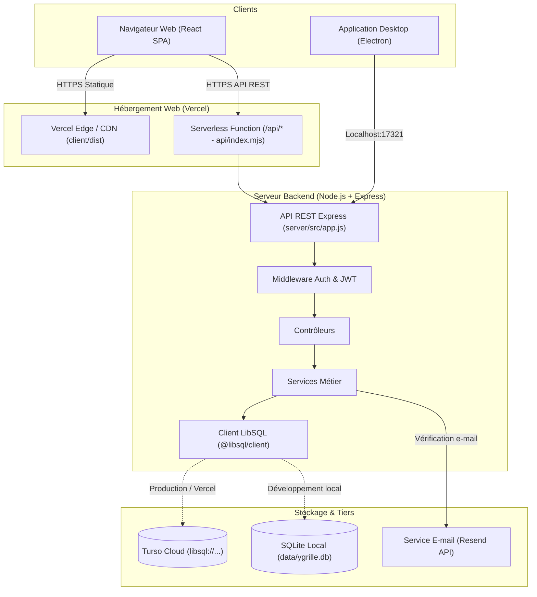

# Architecture technique - YGrille

Ce document décrit l'architecture, le code, les données, les flux et le moteur de calcul de YGrille.

## 1. Vue d'ensemble du système

YGrille utilise un monorepo avec **npm workspaces** :

* **Client (`client/`)** : SPA React 18, Vite, CSS Vanilla.

* **Serveur (`server/`)** : API REST Node.js et Express.

* **Base de données** : SQLite sur Turso ou local.

* **Electron (`electron/`)** : Wrapper desktop optionnel.

* **Vercel (`api/index.mjs` + `vercel.json`)** : Adaptation serverless Vercel.



## 2. Structure du Monorepo

```text
YGrille/
├── client/
│   ├── src/
│   │   ├── api/
│   │   ├── auth/
│   │   ├── components/
│   │   ├── features/
│   │   │   ├── admin/
│   │   │   └── grids/
│   │   │       ├── components/
│   │   │       ├── pages/
│   │   │       ├── defaults.js
│   │   │       ├── grade.js
│   │   │       ├── pdf.js
│   │   │       └── csvExport.js
│   │   ├── styles/
│   │   └── App.jsx
│   ├── vite.config.js
│   └── Dockerfile
├── server/
│   ├── src/
│   │   ├── auth/
│   │   ├── controllers/
│   │   ├── db/
│   │   │   ├── connection.js
│   │   │   ├── schema.sql
│   │   │   ├── init.js
│   │   │   └── setRole.js
│   │   ├── middleware/
│   │   ├── routes/
│   │   ├── services/
│   │   ├── utils/
│   │   ├── app.js
│   │   └── index.js
│   └── Dockerfile
├── electron/
│   ├── main.js
│   └── config.example.js
├── api/
│   └── index.mjs
├── vercel.json
└── docker-compose.yml
```

## 3. Moteur de calcul des notes (`grade.js`)

YGrille calcule les notes par accumulation des points des critères.

### 3.1. Concepts de base

1. **Niveaux d'acquisition** : Chaque grille possède 5 niveaux (positions `0` à `4`) avec un pourcentage (0 à 100%) :

   * Position 0 : *Non évaluable* (0%)

   * Position 1 : *Non acquis* (25%)

   * Position 2 : *En cours d'acquisition* (50%)

   * Position 3 : *Acquis* (75%)

   * Position 4 : *Maîtrisé* (100%)

2. **Points d'un critère** : Le système calcule les points selon le poids et le niveau :

$$\text{Points} = \text{weight} \times \frac{\text{pct}(level)}{100}$$

3. **Score de catégorie** : Chaque catégorie totalise les points obtenus sur ses critères évalués rapportés au total des points de la catégorie :

$$\text{Points Catégorie} = \sum_{c \in \text{cat, évalués}} \text{Points}_c \quad \text{sur} \quad \sum_{c \in \text{cat}} \text{weight}_c$$

4. **Note finale (/20)** : La note finale est la somme globale des points des critères. Si le total des points de la grille vaut 20, la note est directement cette somme. Si le barème totalise un autre nombre de points, elle est ramenée proportionnellement sur 20 :

$$\text{Note Finale (/20)} = \frac{\sum_{c \in \text{évalués}} \text{Points}_c}{\sum_{c \in \text{grille}} \text{weight}_c} \times 20$$

> **Évaluation progressive** : Les critères non encore évalués n'apportent aucun point mais leur poids reste compté dans le total. La note augmente progressivement au fur et à mesure de l'évaluation (avec mention d'évaluation partielle tant que tous les critères ne sont pas renseignés).

### 3.2. Appréciations automatiques

Le système propose des appréciations selon la note :

* $\le 8$ : *Résultats insuffisants, des lacunes importantes restent à combler.*

* $\le 11$ : *Résultats fragiles, un travail de consolidation est nécessaire.*

* $\le 14$ : *Résultats satisfaisants, poursuivez vos efforts.*

* $\le 16$ : *Bons résultats, continuez ainsi.*

* $> 16$ : *Excellents résultats, félicitations.*

## 4. Génération de documents

Le navigateur génère les PDF, ZIP, CSV et JSON. Cela soulage le serveur et évite les dépendances lourdes.

### 4.1. Générateur PDF (`pdf.js`)

* Utilise **`jspdf`** et **`jspdf-autotable`**.

* Format : **A4 Paysage**.

* Style : Bandeau bleu, tableau par catégorie, badges de couleur, points et appréciations.

* Gère la pagination.

### 4.2. Export ZIP (`pdf.js` + `jszip`)

* Compresse les PDF d'une classe dans un fichier `.zip` avec `JSZip`.

### 4.3. Export CSV (`csvExport.js`)

* Génère un fichier CSV `Nom;Prénom;Note`.

* Utilise des séparateurs points-virgules et des virgules décimales.

* Inclut un BOM UTF-8 pour la compatibilité Excel.

### 4.4. Transfert JSON (`jsonTransfer.js`)

* Exporte et importe la structure d'une grille en JSON.

## 5. Sécurité et authentification

1. **Restriction de domaine** : Limite l'inscription aux adresses `@ynov.com`.

2. **Mots de passe** :

   * 12 caractères minimum.

   * 1 majuscule, 1 minuscule, 1 chiffre, 1 caractère spécial.

   * Hachage `bcryptjs`.

3. **Double facteur (E-mail)** :

   * Envoie un code à 6 chiffres.

   * Stocke le hash bcrypt (valide 15 minutes, 5 tentatives maximum).

4. **Jetons JWT** :

   * Signature HMAC SHA-256.

   * Contient l'ID, l'e-mail et le nom.

   * Le serveur vérifie le rôle en base de données pour chaque requête sensible.
