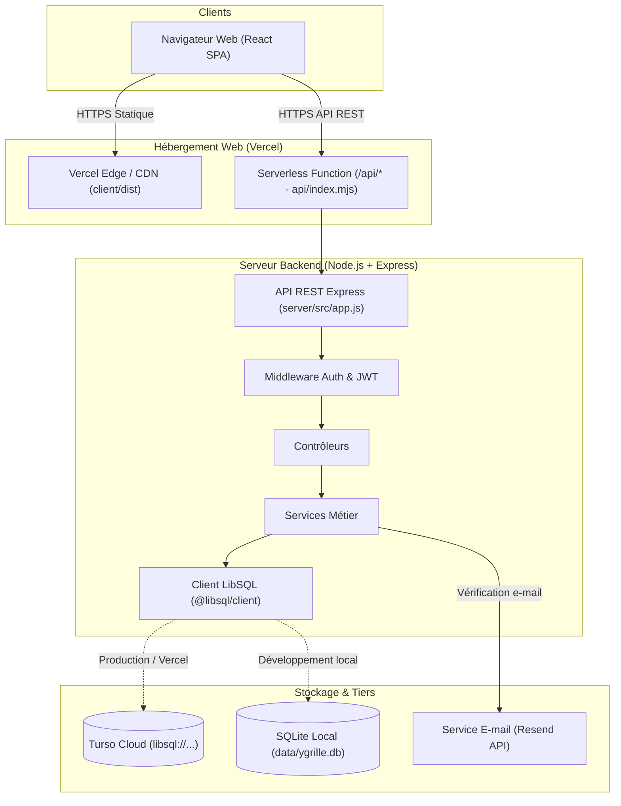

# Architecture technique - YGrille

Ce document décrit l'architecture, le code, les données, les flux et le moteur de calcul de YGrille.

## 1. Vue d'ensemble du système

YGrille utilise un monorepo avec **npm workspaces** :

- **Client (`client/`)** : SPA React 18, Vite, CSS Vanilla.

- **Serveur (`server/`)** : API REST Node.js et Express.

- **Base de données** : SQLite sur Turso ou local.

- **Vercel (`api/index.mjs` + `vercel.json`)** : Adaptation serverless Vercel.



## 2. Structure du Monorepo

```text
YGrille/
├── client/
│   ├── src/
│   │   ├── api/
│   │   ├── auth/
│   │   ├── components/
│   │   ├── features/
│   │   │   ├── admin/
│   │   │   └── grids/
│   │   │       ├── components/
│   │   │       ├── hooks/
│   │   │       ├── pages/
│   │   │       ├── csvExport.js
│   │   │       ├── defaults.js
│   │   │       ├── download.js
│   │   │       ├── grade.js
│   │   │       ├── jsonTransfer.js
│   │   │       ├── lockKeys.js
│   │   │       └── pdf.js
│   │   ├── styles/
│   │   └── App.jsx
│   ├── tests/
│   │   ├── grade.test.js
│   │   └── lockKeys.test.js
│   ├── vite.config.js
│   └── Dockerfile
├── server/
│   ├── src/
│   │   ├── auth/
│   │   ├── controllers/
│   │   ├── db/
│   │   │   ├── connection.js
│   │   │   ├── schema.sql
│   │   │   ├── init.js
│   │   │   ├── migrate.js
│   │   │   └── setRole.js
│   │   ├── middleware/
│   │   ├── routes/
│   │   ├── services/
│   │   ├── utils/
│   │   ├── app.js
│   │   └── index.js
│   ├── tests/
│   │   ├── setup.js
│   │   ├── grids.service.test.js
│   │   ├── locks.service.test.js
│   │   ├── migrate.test.js
│   │   └── validate.test.js
│   └── Dockerfile
├── api/
│   └── index.mjs
├── vercel.json
└── docker-compose.yml
```

## 3. Moteur de calcul des notes (`grade.js`)

YGrille calcule les notes par accumulation des points des critères.

### 3.1. Concepts de base

1. **Niveaux d'acquisition** : Chaque grille possède 5 niveaux (positions `0` à `4`) avec un pourcentage (0 à 100%) :

   - Position 0 : _Non évaluable_ (0%)

   - Position 1 : _Non acquis_ (25%)

   - Position 2 : _En cours d'acquisition_ (50%)

   - Position 3 : _Acquis_ (75%)

   - Position 4 : _Maîtrisé_ (100%)

2. **Points d'un critère** : Le système calcule les points selon le poids et le niveau :

$$\text{Points} = \text{weight} \times \frac{\text{pct}(level)}{100}$$

3. **Score de catégorie** : Chaque catégorie totalise les points obtenus sur ses critères évalués rapportés au total des points de la catégorie :

$$\text{Points Catégorie} = \sum_{c \in \text{cat, évalués}} \text{Points}_c \quad \text{sur} \quad \sum_{c \in \text{cat}} \text{weight}_c$$

4. **Note finale (/20)** : La note finale est la somme globale des points des critères. Si le total des points de la grille vaut 20, la note est directement cette somme. Si le barème totalise un autre nombre de points, elle est ramenée proportionnellement sur 20 :

$$\text{Note Finale (/20)} = \frac{\sum_{c \in \text{évalués}} \text{Points}_c}{\sum_{c \in \text{grille}} \text{weight}_c} \times 20$$

> **Évaluation progressive** : Les critères non encore évalués n'apportent aucun point mais leur poids reste compté dans le total. La note augmente progressivement au fur et à mesure de l'évaluation (avec mention d'évaluation partielle tant que tous les critères ne sont pas renseignés).

### 3.2. Appréciations automatiques

Le système propose des appréciations selon la note :

- $\le 8$ : _Résultats insuffisants, des lacunes importantes restent à combler._

- $\le 11$ : _Résultats fragiles, un travail de consolidation est nécessaire._

- $\le 14$ : _Résultats satisfaisants, poursuivez vos efforts._

- $\le 16$ : _Bons résultats, continuez ainsi._

- $> 16$ : _Excellents résultats, félicitations._

## 4. Génération de documents

Le navigateur génère les PDF, ZIP, CSV et JSON. Cela soulage le serveur et évite les dépendances lourdes.

### 4.1. Générateur PDF (`pdf.js`)

- Utilise **`jspdf`** et **`jspdf-autotable`**.

- Format : **A4 Paysage**.

- Style : Bandeau bleu, tableau par catégorie, badges de couleur, points et appréciations.

- Gère la pagination.

### 4.2. Export ZIP (`pdf.js` + `jszip`)

- Compresse les PDF d'une classe dans un fichier `.zip` avec `JSZip`.

### 4.3. Export CSV (`csvExport.js`)

- Génère un fichier CSV `Nom;Prénom;Note`.

- Utilise des séparateurs points-virgules et des virgules décimales.

- Inclut un BOM UTF-8 pour la compatibilité Excel.

### 4.4. Transfert JSON (`jsonTransfer.js`)

- Exporte et importe la structure d'une grille en JSON.

## 5. Sécurité et authentification

1. **Restriction de domaine** : Limite l'inscription aux adresses `@ynov.com`.

2. **Mots de passe** :

   - 12 caractères minimum.

   - 1 majuscule, 1 minuscule, 1 chiffre, 1 caractère spécial.

   - Hachage `bcryptjs`.

3. **Double facteur (E-mail)** :

   - Envoie un code à 6 chiffres.

   - Stocke le hash bcrypt (valide 15 minutes, 5 tentatives maximum).

4. **Jetons JWT** :

   - Signature HMAC SHA-256.

   - Contient l'ID, l'e-mail et le nom.

   - Le serveur vérifie le rôle en base de données pour chaque requête sensible.

## 6. Verrouillage temps réel et concurrence multi-utilisateurs

YGrille intègre un moteur de concurrence par baux temporaires avec détection de collisions pour l'évaluation collaborative simultanée.

### 6.1. Granularité des clés de verrou

Les clés sont dérivées via `lockKeys.js` :

- `grid:structure` : Verrou global de structure (réservé au propriétaire lors de l'édition des critères).
- `eval:student:<studentId>:crit:<criterionId>` : Verrou de notation par critère et élève.
- `eval:student:<studentId>:general` : Verrou du champ d'appréciation globale.
- En mode groupe, les clés couvrent simultanément tous les étudiants membres de l'équipe évaluée.

### 6.2. Cycle de vie des baux et renouvellement

- **Durée de bail (TTL)** : 90 secondes en base SQLite (`field_locks.expires_at`).
- **Heartbeat automatique (`useLockHeartbeat`)** : Renouvelle les baux actifs toutes les 45 secondes pour les maintenir tant que l'onglet reste ouvert.
- **Bail actif de critère (`useCriterionRowLock`)** : Les clics sur les boutons de niveau acquièrent un bail de 12 secondes avec temporisation d'inactivité. Un guard en vol (`pendingCriterionIdRef`) annule et libère immédiatement les clés obsolètes en cas d'activations rapides successives.
- **Libération au démontage** : La fermeture de l'onglet ou le changement de route React Router libère immédiatement les baux serveur.

### 6.3. Polling adaptatif (`useLockPolling`)

La fréquence de synchronisation s'adapte à l'activité de l'utilisateur :

- **Actif** : 2 500 ms (utilisateur actif sans verrous tiers détectés).
- **Verrouillé** : 2 000 ms (au moins un verrou tiers actif présent).
- **Inactif** : 4 000 ms (au-delà de 120 s sans interaction pointeur ou tactile).
- **Arrière-plan** : 30 000 ms (`document.hidden`).
- En cas de collision concurrente (rejet HTTP `423`), les détails du conflit sont transmis pour afficher un badge indicateur inline sur le critère ou champ concerné.

## 7. Validation et tests automatisés

Le monorepo intègre une suite de tests unitaires et d'intégration native exécutée avec `node --test` :

- **Client** : Calcul du barème (`grade.test.js`), dérivation des clés de verrou et gestion des conflits (`lockKeys.test.js`).
- **Serveur** : Tests d'autorisation et partage (`grids.service.test.js`), service de baux et transactions atomiques (`locks.service.test.js`), migration de schéma (`migrate.test.js`), et validation des schémas de requêtes (`validate.test.js`).
- **Commandes** : `npm test` pour exécuter les tests, `npm run lint` pour ESLint et `npm run format:check` pour Prettier.
