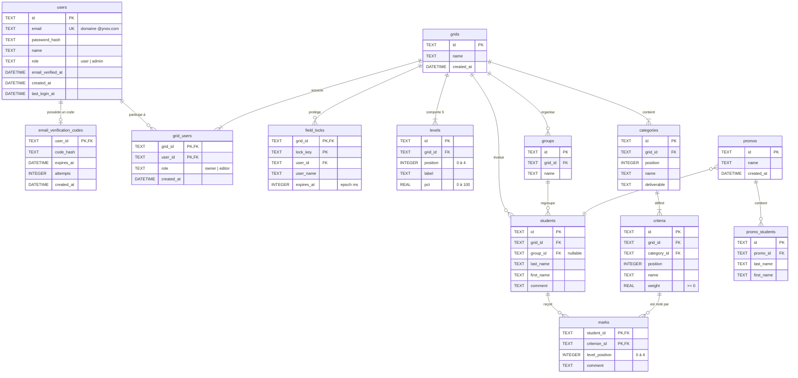

# Modèle de Données et Base SQLite (Turso)

Ce document détaille la base de données relationnelle YGrille, le client libSQL, les contraintes d'intégrité, les index et les scripts d'initialisation.

## 1. Moteur de Base de Données & Pilote LibSQL

YGrille utilise **SQLite** avec **`@libsql/client`**. Cela concilie simplicité locale et évolutivité cloud :

- **Développement local** : Le serveur génère automatiquement le fichier `server/data/ygrille.db` au démarrage.

- **Production** : Le client se connecte à un cluster **Turso** distant via `libsql://`. Les requêtes transitent via l'API HTTP `fetch` pour éviter les dépendances binaires sur Vercel.

### 1.1. Abstraction des requêtes

Le serveur expose quatre fonctions (`server/src/db/connection.js`) :

- `all(sql, args)` : Exécute `SELECT` et renvoie un tableau d'objets.

- `get(sql, args)` : Renvoie le premier résultat ou `undefined`.

- `run(sql, args)` : Exécute une écriture (`INSERT`, `UPDATE`, `DELETE`) et retourne le nombre de lignes modifiées.

- `batch(statements)` : Exécute des commandes dans une transaction atomique avec un seul aller-retour HTTP.

> Sur Turso, les requêtes séquentielles subissent la latence réseau. `batch()` exécute les opérations complexes (création de grille, import de promotion) en quelques millisecondes.

## 2. Schéma Relationnel



## 3. Détail des Tables

Le code applicatif génère les clés primaires `id` (UUID v4) avec `node:crypto.randomUUID()`.

### 3.1. `users`

Enregistre les comptes utilisateurs.

- `id` : `TEXT PRIMARY KEY` (UUID).

- `email` : `TEXT NOT NULL UNIQUE` (restreint à `@ynov.com`).

- `password_hash` : `TEXT NOT NULL`.

- `role` : `TEXT NOT NULL DEFAULT 'user' CHECK (role IN ('user', 'admin'))`.

### 3.2. `email_verification_codes`

Codes numériques temporaires.

- `user_id` : `TEXT PRIMARY KEY REFERENCES users(id) ON DELETE CASCADE`.

- `code_hash` : `TEXT NOT NULL` (hash bcrypt du code à 6 chiffres).

- `expires_at` : `DATETIME NOT NULL` (15 minutes).

- `attempts` : `INTEGER NOT NULL DEFAULT 0` (5 tentatives max).

### 3.3. `grids`

Définition d'une grille d'évaluation.

- `id` : `TEXT PRIMARY KEY` (UUID).
- `name` : `TEXT NOT NULL`.
- `created_at` : `DATETIME NOT NULL DEFAULT CURRENT_TIMESTAMP`.

### 3.4. `grid_users`

Table de jonction gérant l'appartenance et les rôles collaboratifs.

- `grid_id` : `TEXT NOT NULL REFERENCES grids(id) ON DELETE CASCADE`.
- `user_id` : `TEXT NOT NULL REFERENCES users(id) ON DELETE CASCADE`.
- `role` : `TEXT NOT NULL DEFAULT 'owner' CHECK (role IN ('owner', 'editor'))`.
- `created_at` : `DATETIME NOT NULL DEFAULT CURRENT_TIMESTAMP`.
- Clé primaire composite `(grid_id, user_id)`.

> **Trigger `trg_delete_orphaned_grids`** : Déclenché après chaque `DELETE` sur `grid_users`. Si aucun collaborateur ne subsiste sur la grille, celle-ci est automatiquement supprimée par cascade.

### 3.5. `field_locks`

Baux de verrouillage de concurrence en temps réel pour l'édition collaborative.

- `grid_id` : `TEXT NOT NULL REFERENCES grids(id) ON DELETE CASCADE`.
- `lock_key` : `TEXT NOT NULL` (ex: `grid:structure`, `eval:student:ID:crit:ID`, `eval:student:ID:general`).
- `user_id` : `TEXT NOT NULL REFERENCES users(id) ON DELETE CASCADE`.
- `user_name` : `TEXT NOT NULL`.
- `expires_at` : `INTEGER NOT NULL` (horodatage Unix epoch en millisecondes).
- Clé primaire composite `(grid_id, lock_key)`.

### 3.6. `levels`

Échelle d'acquisition (5 niveaux).

- `position` : `INTEGER NOT NULL CHECK (position BETWEEN 0 AND 4)`.

- `pct` : `REAL NOT NULL CHECK (pct BETWEEN 0 AND 100)`.

### 3.7. `categories`

Pôles d'évaluation.

- `id`, `grid_id`, `position`, `name`, `deliverable`.

### 3.8. `criteria`

Critères individuels.

- `weight` : `REAL NOT NULL CHECK (weight >= 0)`.

### 3.9. `groups`

Groupes d'étudiants.

- `id`, `grid_id`, `name`.

### 3.10. `students`

Élèves évalués.

- `group_id` : `TEXT REFERENCES groups(id) ON DELETE SET NULL`.

### 3.11. `marks`

Évaluations par élève et critère.

- `level_position` : `INTEGER NOT NULL CHECK (level_position BETWEEN 0 AND 4)`.

### 3.12. `promos` & `promo_students`

Référentiel global de promotions.

## 4. Stratégie d'Indexation

SQLite n'indexe pas automatiquement les clés étrangères. Sans index, les requêtes filtrées provoquent des scans complets de tables. Le fichier `schema.sql` crée ces index :

- `idx_grid_users_user`, `idx_grid_users_grid`

- `idx_field_locks_expiry`

- `idx_criteria_grid`, `idx_criteria_category`

- `idx_groups_grid`

- `idx_students_grid`, `idx_students_group`

- `idx_promo_students_promo`

- `idx_marks_criterion`

## 5. Maintenance

### 5.1. Initialisation du schéma

La commande exécute `server/src/db/init.js`. Le script applique `schema.sql` et vérifie les colonnes manquantes.

```bash
TURSO_DATABASE_URL="libsql://ygrille-ynov624.aws-eu-west-1.turso.io" \
TURSO_AUTH_TOKEN="votre-token-turso" \
npm run db:init -w server
```

### 5.2. Migration incrémentale

La commande exécute `server/src/db/migrate.js`. Elle effectue de façon idempotente la transition de `grids.user_id` vers `grid_users` et garantit la présence de la table `field_locks` et de ses index.

```bash
TURSO_DATABASE_URL="libsql://ygrille-ynov624.aws-eu-west-1.turso.io" \
TURSO_AUTH_TOKEN="votre-token-turso" \
npm run db:migrate -w server
```

### 5.3. Attribution des rôles

Cette commande promeut ou rétrograde un utilisateur.

```bash
TURSO_DATABASE_URL="libsql://ygrille-ynov624.aws-eu-west-1.turso.io" \
TURSO_AUTH_TOKEN="votre-token-turso" \
npm run user:role -w server -- prenom.nom@ynov.com admin
```
