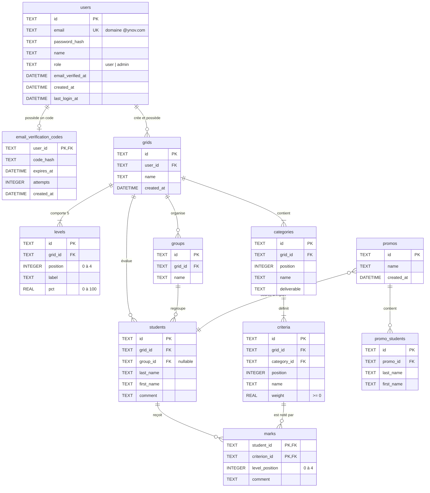

# Modèle de Données et Base SQLite (Turso)

Ce document détaille la base de données relationnelle YGrille, le client libSQL, les contraintes d'intégrité, les index et les scripts d'initialisation.

## 1. Moteur de Base de Données & Pilote LibSQL

YGrille utilise **SQLite** avec **`@libsql/client`**. Cela concilie simplicité locale et évolutivité cloud :

* **Développement local** : Le serveur génère automatiquement le fichier `server/data/ygrille.db` au démarrage.

* **Production** : Le client se connecte à un cluster **Turso** distant via `libsql://`. Les requêtes transitent via l'API HTTP `fetch` pour éviter les dépendances binaires sur Vercel.

### 1.1. Abstraction des requêtes

Le serveur expose quatre fonctions (`server/src/db/connection.js`) :

* `all(sql, args)` : Exécute `SELECT` et renvoie un tableau d'objets.

* `get(sql, args)` : Renvoie le premier résultat ou `undefined`.

* `run(sql, args)` : Exécute une écriture (`INSERT`, `UPDATE`, `DELETE`) et retourne le nombre de lignes modifiées.

* `batch(statements)` : Exécute des commandes dans une transaction atomique avec un seul aller-retour HTTP.

> Sur Turso, les requêtes séquentielles subissent la latence réseau. `batch()` exécute les opérations complexes (création de grille, import de promotion) en quelques millisecondes.
>
>

## 2. Schéma Relationnel



## 3. Détail des Tables

Le code applicatif génère les clés primaires `id` (UUID v4) avec `node:crypto.randomUUID()`.

### 3.1. `users`

Enregistre les comptes utilisateurs.

* `id` : `TEXT PRIMARY KEY` (UUID).

* `email` : `TEXT NOT NULL UNIQUE` (restreint à `@ynov.com`).

* `password_hash` : `TEXT NOT NULL`.

* `role` : `TEXT NOT NULL DEFAULT 'user' CHECK (role IN ('user', 'admin'))`.

### 3.2. `email_verification_codes`

Codes numériques temporaires.

* `user_id` : `TEXT PRIMARY KEY REFERENCES users(id) ON DELETE CASCADE`.

* `code_hash` : `TEXT NOT NULL`.

* `expires_at` : `DATETIME NOT NULL` (15 minutes).

### 3.3. `grids`

Définition d'une grille.

* `id`, `user_id` (`ON DELETE CASCADE`), `name`, `created_at`.

### 3.4. `levels`

Échelle d'acquisition (5 niveaux).

* `position` : `INTEGER NOT NULL CHECK (position BETWEEN 0 AND 4)`.

* `pct` : `REAL NOT NULL CHECK (pct BETWEEN 0 AND 100)`.

### 3.5. `categories`

Pôles d'évaluation.

* `id`, `grid_id`, `position`, `name`, `deliverable`.

### 3.6. `criteria`

Critères individuels.

* `weight` : `REAL NOT NULL CHECK (weight >= 0)`.

### 3.7. `groups`

Groupes d'étudiants.

* `id`, `grid_id`, `name`.

### 3.8. `students`

Élèves évalués.

* `group_id` : `TEXT REFERENCES groups(id) ON DELETE SET NULL`.

### 3.9. `marks`

Évaluations par élève et critère.

* `level_position` : `INTEGER NOT NULL CHECK (level_position BETWEEN 0 AND 4)`.

### 3.10. `promos` & `promo_students`

Référentiel global de promotions.

## 4. Stratégie d'Indexation

SQLite n'indexe pas automatiquement les clés étrangères. Sans index, les requêtes filtées provoquent des scans complets de tables. Le fichier `schema.sql` crée ces index :

* `idx_grids_user`

* `idx_criteria_grid`, `idx_criteria_category`

* `idx_groups_grid`

* `idx_students_grid`, `idx_students_group`

* `idx_promo_students_promo`

* `idx_marks_criterion`

## 5. Maintenance

### 5.1. Initialisation du schéma

La commande exécute `server/src/db/init.js`. Le script applique `schema.sql` et vérifie les colonnes manquantes.

```bash
TURSO_DATABASE_URL="libsql://ygrille-ynov624.aws-eu-west-1.turso.io" \
TURSO_AUTH_TOKEN="votre-token-turso" \
npm run db:init -w server
```

### 5.2. Attribution des rôles

Cette commande promeut ou rétrograde un utilisateur.

```bash
TURSO_DATABASE_URL="libsql://ygrille-ynov624.aws-eu-west-1.turso.io" \
TURSO_AUTH_TOKEN="votre-token-turso" \
npm run user:role -w server -- prenom.nom@ynov.com admin
```
